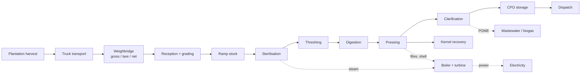
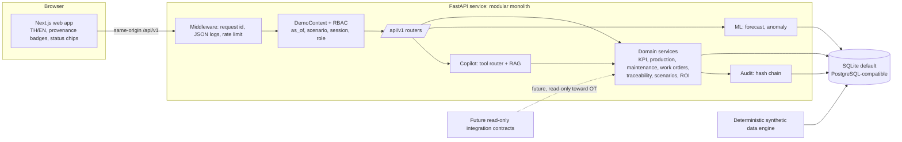

# Designing an AI-Driven Industrial Intelligence Platform for Palm Oil Manufacturing

> **Independent technical case study of a concept demo. Not an official system of any company.** All data is **synthetic** and
> describes a fictional mill ("Demo Palm Mill A"). Nothing here is a measurement of any real plant. Every statement of
> what works is backed by a row marked `verified` in `docs/portfolio/CAPABILITY_MATRIX.md`; anything else is stated as a caveat or an owner decision.
> Where a model lost to a simple baseline, this document says so.

## 1. Summary

The project asks one question: *what would a careful, evidence-first intelligence layer for a palm oil mill look like,
and how would we know it works?* The answer built so far is a Python service that generates and serves a physically
consistent synthetic mill, computes the plant's KPIs from stored records, classifies equipment health from explicit
criteria, runs a confirmed work-order loop with an audit trail, evaluates eight classical ML models against naive
baselines on a later held-out period, and turns operational improvement into a transparent, illustrative business case.

| At a glance | Value | Evidence |
|---|---|---|
| Synthetic dataset | 120 days, 1,569,016 rows, 35 equipment items, 112 sensors, 11,813 truck trips, six linked scenario episodes | `verified` (CM-01): seed checksum reproduced, mass balance and ticket arithmetic re-checked by SQL |
| Data-quality checks | 58 of 58 pass, including determinism | `verified` (CM-02) |
| API and security controls | Typed REST API, simulated-role permissions enforced server side, rate limiting, hash-chained audit log | `verified` (CM-04): full test suite 1,139 passed, 2 skipped, 0 errors (final run) |
| ML models | 8 models; the OER forecast (at hour, shift and day level), the energy forecast and the arrival forecast do **not** beat baselines; the energy anomaly detector also missed its single test event (agent-reported) | `verified` (CM-15 to CM-19) |
| Press-bearing detector | First detection 56.5 h before the rule warning and 148.3 h before the rule critical alarm, on a prescribed synthetic curve | `verified` (CM-17) |
| ROI simulator | Four cases, no double counting, arithmetic recomputed by hand | `verified` (CM-13) |
| Executive page; maintenance, equipment and work-order pages; logistics page; Copilot core | Built; covered by 20 end-to-end scenario tests (scenarios A to E), the full suite (1,139 passed) and orchestrator browser checks of the executive page | Verified (CM-24, CM-28, CM-29a, CM-30a). The Copilot answers about half of fresh paraphrases correctly and asks for clarification in about a third |
| Other screens, Copilot evaluation and page, guided tour | Digital twin, palm-mill, scenario-simulator and business-impact pages built; traceability built and tested in the suite; energy page partial; Copilot evaluation re-run; guided tour runs in the end-to-end tests | Energy page is partial and checked only by agent browser runs (CM-29b). The Copilot LLM mode is tested only with a fake provider (CM-30b). The tour's "5 minutes" is a design target, not a timed measurement (CM-32) |
| Deployment | Docker images and CI configured, never built or run; no public URL | **[PENDING VERIFICATION · CM-36: Docker build and GitHub Actions run not yet performed]**; no public deployment (CM-37) |

**How it was built (disclosure).** The project was designed, directed and reviewed by the applicant with AI coding
agents working under written ownership boundaries, a shared specification and a rule that a task counts as done only
with evidence. An orchestrator re-ran key checks independently of the agents; that log
(the engineering log (kept private)) is the basis for every `verified` label here. *Owner to confirm the wording of this
paragraph and the extent of hands-on work:* **TODO (owner).**

## 2. Objective

Deliver, as an inspectable artefact rather than a slide deck, evidence that the author can:

1. understand an industrial process well enough not to simulate it wrongly (mass balance, capacity, steam and energy
   relations);
2. engineer applied AI honestly (temporal evaluation, baselines, leakage control, uncertainty, model cards);
3. design a modular, typed, testable architecture with security defaults;
4. express operational improvement as a traceable business case;
5. plan and lead delivery: roadmap, dependencies, risks, evidence.

## 3. Why it matters

- Palm oil is a high-volume, thin-spread, seasonal business. At the April 2026 public price quotes used by the project's
  researcher, the oil extracted from a tonne of FFB is worth roughly what the fruit is quoted at (the public-facts research (kept private)
  PF-043; our arithmetic, illustrative), so extraction efficiency, downtime and conversion cost carry weight.
- Small effects are hard to see. In the synthetic data, normal day-to-day OER noise is about 0.25 percentage points
  (pp), while an equipment fault such as the press-bearing scenario shifts plant OER only about 0.2 to 0.3 pp. Detecting
  it from OER alone is not reliable; it needs the machine's own sensors. This is the kind of reasoning an operations
  dashboard has to support.
- Trust is the bottleneck for industrial AI. A model without a baseline, a score that looks like a probability and a
  chart that breaks mass balance each cost credibility. The project is designed around not doing those things.

## 4. Industrial context

The workflow modelled (*Industry Practice*, synthesised from public engineering sources with stated confidence levels in
`docs/business/PALM_MILL_PROCESS.md`; the real configuration of any particular mill will differ):

Key relations the synthetic data must obey, with their consequences:

- **Mass balance.** CPO = FFB processed x OER; kernel = FFB x KER. By-products (EFB, fibre, shell, POME) are fractions
  of FFB. The five outputs sum to about 64 % of FFB mass (the rest is water and evaporation), never 100 %.
- **Capacity and starvation.** Throughput cannot exceed the limiting stage (sterilisers, presses, steam). A mill with no
  fruit waiting is *starved*, which is not downtime.
- **OER is a diagnostic, not a score.** Its definition has pitfalls (stock changes, tank-dip error, thresholds on a
  different basis), recorded in `docs/business/KPI_DEFINITIONS.md`. All KPIs use ratio of sums, never a mean of
  daily percentages.
- **Fruit freshness.** Free fatty acid rises with time from harvest to processing, so truck queues and ramp stock reach
  into oil quality.

## 5. Solution architecture

Status: the Python service, database, services, ML and audit are `verified` or reported (CM-03 to CM-22). The web
application's public foundation is `verified` (CM-33, CM-34). The executive, maintenance and logistics pages and the
Copilot core are verified by the end-to-end scenario tests and the full suite; the digital twin, palm-mill, scenario-simulator and business-impact pages are built; the energy page is partial (CM-29b); the Copilot evaluation has been re-run and its LLM mode is tested only with a fake provider (CM-30b).

Layers and rules (`docs/architecture/SYSTEM_ARCHITECTURE.md`): the web tier renders and proxies only; **all analytics,
business rules and AI live in Python** so one number is computed once; services take an explicit `DemoContext` and
never read the wall clock for demo data; the Copilot calls services through allow-listed tools and never raw SQL.

**Request lifecycle.** Request id and JSON log, then rate limit (per IP and per session), then context validation
(`as_of`, `scenario_id`, session, role), then a permission check, then handler, service and database. Writes append an
audit record in the same transaction. Every error uses one envelope. This is covered by tests (CM-04).

## 6. Design decisions

Full text: `docs/DECISIONS.md` (17 ADRs). The ones that shaped the work:

| ADR | Decision | Why it matters |
|---|---|---|
| ADR-001 | Modular monolith (pnpm workspace plus one Python service) | One deploy unit per tier, boundaries are packages, a module can be extracted later without changing the API |
| ADR-002 | All numbers computed in Python | Dashboard, export and Copilot cannot disagree |
| ADR-003 | SQLite default, PostgreSQL-compatible schema | "Clone, seed, run" with zero infrastructure. PostgreSQL verified only as offline DDL |
| ADR-004 | REST plus OpenAPI to generated TypeScript types | The frontend is type-checked against the real contract. The contract was regenerated on 2026-11-22 (95 paths, 0 stubs). |
| ADR-005 | **Scenario playback, not data mutation.** One deterministic 120-day timeline; the client chooses the clock (`as_of`) | Reproducible demo for many visitors, cross-module consistency by construction |
| ADR-006 | Mutable records scoped to a demo session; seeded rows are a shared read-only baseline | Visitors cannot corrupt each other's demo |
| ADR-007 | Simulated roles via header, enforced server side, tested | Demonstrates authorisation honestly labelled as not authentication |
| ADR-009 | Classical ML with naive baselines and temporal splits | No deep learning without justification; losses are reported |
| ADR-010 | Copilot: deterministic tool router plus optional LLM adapter | Works with no API key; a language model never receives database access. Implementation: the router is verified by the evaluator re-run (section 8.7); the optional LLM adapter is tested only with a fake provider. |
| ADR-011 | One continuous timeline with embedded scenario episodes | Cross-module consistency is automatic |
| ADR-012 | In-process token-bucket rate limiter | Public demo protection without extra infrastructure; per-process limit is a stated limitation |
| ADR-013 | Append-only audit log with a hash chain | Tamper-evident history; not tamper-proof against a database administrator |
| ADR-014 | Copy-on-write for changes to seeded rows | Baseline stays pristine; a visitor's change is a session copy |
| ADR-017 | Mass-balance traceability by default | Supplier shares, never physical certainty and never a certification claim |

**Design intent is not evidence.** A scenario's description says what it was *designed* to do; the data show what it
*actually* does. The product shows only effects measured from the data. For example, the press-vibration scenario is
described as hurting OER, but the measured plant OER effect is about 0.17 to 0.3 pp, within normal noise, and the API says
so ("within normal day-to-day variation").

## 7. Data engineering and reliability

### 7.1 Method

A deterministic generator (seed 20261120; same seed, same content checksum) builds one fictional mill from a
sourced parameter set: 169 parameters, each tagged with the fact taxonomy (Verified Public Fact, Industry Practice,
Engineering Assumption, Synthetic Demonstration Data), 46 sources, and explicit "deviations from researcher values" with
reasons (`docs/DATA_GENERATION.md`). Supply, trucks, queue, mill state, oil losses, steam, electricity, sensors, alerts and
maintenance records are generated from the **same hourly state**, so views agree by construction:

- **Supply and logistics.** Seasonal, weather and supplier-quality effects; trucks in convoys through gate, weighbridge,
  grading, unloading and exit with interval-booked servers and outages.
- **Mill.** FIFO ramp stock, capacity as the minimum over sterilisers, presses and steam, planned and unplanned stops,
  oil-loss terms for EFB, condensate, fibre, sludge and nuts, and OER and FFA formulas that move with the drivers.
- **Steam and energy.** Steam demand and supply set pressure deficits that lengthen sterilisation cycles and cool
  digesters; electricity from motor load with grid and diesel fall-backs; biomass fuel balance.
- **Sensors.** 1.36 million readings with thermal lags, dropouts and labelled faults. Presses and the feed-water pump use
  10-minute sampling because the scenarios depend on them; other tags use 15 to 60 minutes (a stated trade-off).

### 7.2 Scenario episodes

| Scenario | Window (local) | What is injected | Measured chain (generator report: full local focus day against a reference day, NORMAL_DAY 10-21 for OER_DEGRADATION and the pre-onset day 11-05 for TRUCK_QUEUE_CONGESTION and PRESS_VIBRATION_ANOMALY, see docs/DATA_GENERATION.md section 6; the UI instead measures cumulative-to-clock against the trailing 28 days, so its figures differ, e.g. OER_DEGRADATION 17.64 against 18.56 %) |
|---|---|---|---|
| ENERGY_EFFICIENCY_DROP | 09-07 to 09-14 | Boiler fouling, steam-trap leak, idle running, air leak | kWh/t +9.3 %, steam per tonne +11.5 % week on week |
| OER_DEGRADATION | 09-30 to 10-06 | Rain, unripe fruit, short sterilisation, worn screws, clarifier fault | OER 17.71 against 18.52 % (-0.81 pp) |
| NORMAL_DAY | 10-21 | None | Reference day |
| STEAM_PRESSURE_DEVIATION | 10-29 | Feed-water pump cavitation | Drum and header pressure low, sterilisation cycle 93 against 80 min |
| TRUCK_QUEUE_CONGESTION | 11-12 to 11-16 | Rain then arrivals surge, weighbridge outage | Mean wait to weigh 29.6 against 5.5 min |
| PRESS_VIBRATION_ANOMALY | 11-16 to 11-21 (onset 11-06) | Bearing wear on press PRS-03 | Vibration 5.32 against 1.80 mm/s; bearing temperature 88.5 against 65.4 degrees C; OER 18.20 against 18.42 % |

All effect sizes are synthetic. Several are smaller than first designed (the queue episode was physically implausible at
the original size), and each deviation from the researcher's parameter is recorded with a reason.

### 7.3 Reliability checks

The validator (58 checks, `verified`, CM-02) covers referential integrity; no data outside the window; one hourly row
per hour; CPO and kernel equal FFB times the rate; throughput at most 60 t/h; ramp continuity; batch inputs equal batch
FFB; lot quantity equals the sum of compositions; produced equals dispatched plus stock; steam, electricity and water in
range; net weight equals gross minus tare on every ticket; every sensor alert derivable from a stored reading; the audit
chain verifies; and the content checksum equals the manifest.
The orchestrator independently reproduced the checksum and checked totals by SQL (FFB 111,814 t to CPO 20,643 t; 1,110
batches; 11,813 tickets).

### 7.4 Limits (stated everywhere)

One fictional mill, one line, 120 days; no annual shutdown or lean season; losses and OER are parametric functions plus
noise, not process physics; degradation curves are prescribed power laws; prices are an illustrative random walk;
comparison days have no daily noise draw (a demo design choice stated so no one mistakes it for natural variation).
Because we wrote the generator, any model can in principle learn the generator, which is why leakage control is a first
class concern (section 8.3).

## 8. AI modelling approach

### 8.1 Protocol

| Item | Rule |
|---|---|
| Split | Temporal: train before 2026-10-15 (Bangkok), test from then on (37 days) |
| Selection | Inside training only (expanding-window folds, threshold grids) |
| Test use | Each model evaluated once on the test period; no re-selection afterwards |
| Forecast metrics | MAE and RMSE against naive baselines (persistence, 24 h seasonal naive, 24 h rolling mean, hour-by-weekday profile, linear signature) |
| Anomaly metrics | Event level: precision, recall, false positives per day, detection latency; compared with rule-threshold alarms and Isolation Forest |
| Ground truth | 54 injected labels, read only by evaluation code, never by features or the API |
| Causality | Expanding medians and MADs from data older than two days; weekly refits using past data only; `detected_at` set at the end of the hour in which the persistence rule fired |

### 8.2 Honest results (synthetic benchmark)

| Model | Result on the test period | Best baseline | Beats baseline? | Status |
|---|---|---|---|---|
| AI-B01 OER forecast (hourly) | MAE 0.268 pp | 24 h rolling mean 0.237 pp | **No** (a train-mean constant gives about 0.26) | `verified` (CM-15) |
| AI-B02 production anomaly | Precision 1.00, recall 4 of 7 | Isolation Forest recall 1 of 7 | Yes against Isolation Forest | precision and recall `verified`; comparison and latency claimed (CM-16) |
| AI-C02 equipment anomaly | Recall 4 of 6, 0 false positives per day | Rule alarms: recall 2 of 6 | Yes | lead time `verified`; per-label table claimed (CM-17) |
| AI-E01 energy forecast (hourly) | MAE 10.90 kWh/h | Linear signature 9.67 | **No** | `verified` (CM-18) |
| AI-E02 energy anomaly | Recall 0 of 1 | Daily 18.5 kWh/t rule also 0 of 1 | **No** | claimed (CM-18) |
| AI-D01 queue time | MAE 2.72 min | Queue-drain 2.78 | Marginally | `verified` (CM-19) |
| AI-D02 arrival forecast | MAE 2.109 trucks per hour | Hour-by-weekday profile 2.101 | **No** | `verified` (CM-19) |
| AI-D04 logistics flags | Weight: no false flags; waits: recall 2 of 3 | n/a | n/a | claimed (CM-19) |

The orchestrator retrained from a clean database copy and reproduced these figures. The label counts are small (7
production, 6 equipment, 1 energy and 3 logistics labels in the test period), so every rate has wide uncertainty.

### 8.3 Leakage audit

Because the generator is ours, leakage is the first risk, not the last. The design (`docs/MODEL_EVALUATION.md`
section 8): no forecast feature may be named after OER, KER, CPO, oil loss, injected labels, scenarios or labels
(checked at import and in tests); the single allowed exception is the mean of the 24 observed OER values *strictly
before* the hour; oil-loss columns are anomaly signals only, never OER features; features at time t must be identical
with and without data after t; labels are read only by evaluation code; scenario windows slice errors but never feed a
detector; and thresholds are tuned on training data only.
The leakage tests are part of the full run at hand-back (1,139 passed, 2 skipped: an opt-in seed test and one stub-count test), which includes the ML tests.

### 8.4 What the results teach

1. **Run the trivial baseline first.** A gradient-boosted model on lagged OER and process drivers lost to a one-line
   rolling mean, and was about as good as a constant. Without the baseline this would have shipped as "AI forecasts OER".
2. **Know the noise ceiling.** Hourly OER carries hourly and daily noise no same-hour driver explains. Aggregating did
   not rescue the forecast either: the model also lost at shift level (0.205 against 0.146 pp) and day level (0.219 against
   0.161 pp). The useful product is an *expected band* and a residual alert, not a point forecast: a day-level band of about
   +/-0.49 pp flagged the OER_DEGRADATION episode (-0.86 pp) out of sample (agent-reported band; the aggregation losses
   are in the orchestrator's log).
3. **An explanation can be wrong even when the number is fine.** The model's driver attribution for OER turned out to be
   *wrong-signed out of sample* (plausible in sample, misleading afterwards). The rule adopted: the screens and the Copilot
   explain a deviation with observed driver values against their normal ranges, not with model attribution.
4. **Selection discipline.** A ridge variant scored lower test error (0.239 pp) than the served model, but choosing it
   after seeing the test set would be test-set selection, so it was not served. The energy anomaly detector missed its
   single test event because of a threshold tie-break rule fixed on training data; the rule was not changed after the
   miss.
5. **Judge detectors by lead time and false alarms, not accuracy.** Event-level precision, recall, false positives per
   day and latency tell an engineer what an alert would have meant on a shift.
6. **Misses are information.** Breakdowns where a machine simply stops carry no running-hour data, so a sensor-trend
   detector cannot see them; those belong to state and downtime monitoring.
7. **A win on synthetic data proves the pipeline, not the physics.** Every card says so.

### 8.5 Detection with lead time: the press bearing

Press PRS-03 in the PRESS_VIBRATION_ANOMALY episode wears from an onset on 2026-11-06. The ML detector first fired on
2026-11-13 06:00 local, **56.5 hours before the rule-based warning and 148.3 hours before the rule-based critical alarm**
(verified, CM-17; timestamps from `docs/MODEL_EVALUATION.md`). The same machine then crosses explicit health thresholds
(vibration ISO 10816-3 zone D and bearing temperature above its warning limit), the equipment state becomes `critical`
(verified, CM-10) and the recommendation is to inspect the bearing before continued use. It is advisory.

**Caveat, repeated everywhere:** the generator prescribes a smooth power-law degradation, so this lead time says nothing
about real bearings. A real plant would need failure history to calibrate it. A stopped machine, a 30-minute sensor
spike and breakdowns are cases the detector misses, and they are reported as misses.

### 8.6 Equipment health and risk

State per sensor (normal, warning, critical) from warn and critical limits; equipment state is the worst sensor state,
and **Maintenance Required** applies when an active work order exists. The same function serves the process twin and the
maintenance view, so they cannot disagree (a test compares all 35 equipment states). The failure-risk index (0 to 100)
weights condition, trend, service interval, open alerts and corroborating sensors. It is a *relative ranking*, not a
calibrated probability, and the response carries its meaning and limits.
Health state verified (CM-10); the index components are covered by the full suite but their numbers are not orchestrator-checked, and the index is relative.

### 8.7 Computer vision and Copilot

- **Computer vision FFB grading is a research prototype.** No licensed labelled dataset was available, so no grader was
  trained and no accuracy is claimed; the prototype provides safe upload, colour statistics and the dataset, camera,
  lighting and labelling protocol a pilot would need. The prototype is agent-built and tested for upload safety; no accuracy is claimed.
- **The Industrial Operations Copilot** is designed as a deterministic intent router calling allow-listed, role-checked
  tools over the same services, with retrieval over newly authored sample documents, citations, and an optional language
  model that never sees raw SQL (ADR-010). Verified by the orchestrator's evaluator re-run: grounded answers 45 of 45; no-data refusals 12 of 12; unauthorised tool requests refused 23 of 23; prompt injections refused 26 of 26. On a held-out set of 46 fresh paraphrases the router gave 25 correct, 16 clarified and 5 wrong: it answers about half correctly and asks for clarification in about a third. The optional LLM mode has been tested only with a fake provider; no real model has been called.

## 9. Human-in-the-loop workflow

Alert, engineer review, work order, assigned technician, maintenance record, resolved, with an audit entry for every
change. A work order is created only with an explicit confirmation flag; a resolve requires notes; invalid jumps return
409; writes without a demo session return 428; another visitor's record returns 404; session reset removes only the
caller's records; the audit chain verifies. The orchestrator ran this against a live API on a database copy (CM-11, CM-04).
Changes to a seeded record create a session copy (copy-on-write), so the shared baseline stays untouched.

## 10. Business-impact method

The ROI simulator takes daily FFB, operating days, current and target OER, price, downtime hours, capacity, energy cost,
maintenance cost, expected efficiency gain, implementation cost and recurring cost. It reports four cases (Baseline,
Conservative, Expected, Optimistic), net benefit, payback and a sensitivity analysis (CM-13).

- **No double counting.** OER uplift applies to the baseline FFB only; recovered downtime hours are valued at the *current*
  OER over a disjoint FFB base. The orchestrator recomputed one example by hand with the original defaults, which were later replaced (+0.5 pp OER: 1,367.1 t from OER plus 799 t from
  recovered hours equal 2,166 t; cost avoidance 1,413,418 THB), and it matched the API.
- **Calibration story.** The first defaults gave a payback of about one month. The arithmetic was right but the headline
  was not credible, so the defaults were recalibrated to modest assumptions (+0.10 pp OER, 5 % downtime reduction, 3 %
  efficiency, 12 M THB implementation, 3.6 M THB per year recurring, all labelled Engineering Assumptions). The
  conservative case then shows a **negative** first-year net (-7.9 M THB, payback about 28 months), the expected case
  +3.4 M THB (about 9.3 months) and the optimistic +8.8 M THB (about 6.8 months).
- **Disclaimer on every output:** *Illustrative business scenario based on adjustable assumptions, not verified financial results of any
  company.* These are not forecasts and not company figures.

## 11. Software engineering practices

- Typed Pydantic schemas and OpenAPI-generated TypeScript types; strict type checking.
- Directory ownership per module and one-writer rules; ADRs for decisions; additive-only schema changes after a freeze.
- Evidence rule: tasks are done only with a command or test result in a status file; an orchestrator re-runs the important
  checks (KPI against direct SQL, ROI by hand, work-order flow live, retraining from scratch, seed checksum).
- Determinism everywhere: seeded generator, seeded models, no wall-clock reads for demo data.
- Status labels (`implemented`, `partial`, `prototype`, `planned`) in the UI come from one file that only the orchestrator
  promotes after verifying evidence.
- Ruff linting and a Python test suite; web typecheck, lint, 75 vitest tests (TH and EN key parity) and 20 Playwright scenario tests.

**Delivery lessons (project management).** Tooling usage limits interrupted long agent runs at least three times. The response was
smaller waves, one writer per path, and status files updated after every finished item so an interruption costs little.
Early agent claims were re-verified rather than trusted, which caught a failing leakage test, an over-optimistic ROI
default and an uncalibrated queue-simulation baseline before they reached a document.

## 12. Security (demo grade)

Read-only AI; human confirmation before record changes; server-side role permissions (simulated); per-session sandbox;
token-bucket rate limiting per IP and per session; strict input validation; safe upload handling (size cap, allow-list,
magic-byte sniffing, sanitised names); append-only hash-chained audit; no secrets in the repository (`.env.example`
only); demo and production configuration kept apart. These are `verified` at test level (CM-04). Agent-reported only:
hashing of IP addresses in access logs and metadata stripping on the computer-vision upload (not separately verified). **Not done:** penetration testing and an external security review. Security headers, request-size limits and input-fuzzing tests were added and run in the full suite (QA-02, QA-03; 1,139 passed). `docs/SECURITY.md` has been written. Roles are not authentication.

## 13. Testing methodology: what was actually run

| Check | Result | Who ran it |
|---|---|---|
| Python test suite | 1,139 passed, 2 skipped (opt-in seed test and one stub-count test), 0 errors | Orchestrator (final run) |
| Web: typecheck, lint, 75 vitest tests, production build 34 of 34 pages, 20 Playwright scenario tests | Pass | Orchestrator |
| Seed rebuild and checksum | Equals the committed manifest | Orchestrator |
| Validator | 58 of 58 | Data engine, checked by the orchestrator |
| KPIs against direct SQL, 7-day window | Equal (FFB 5,735.205 t, CPO 1,059.951 t, OER 18.481 %) | Orchestrator |
| ML retrain from a clean copy | Every reported number reproduced | Orchestrator |
| Work-order and RBAC matrix on a live API | As designed | Orchestrator |
| ROI by hand | Matches | Orchestrator |
| Earlier agent-reported totals (359, 362, 799) | Superseded by the final full run (1,139 passed) | ML and copilot agents |
| **Not run:** Docker build and compose, GitHub Actions, live PostgreSQL, load test, penetration test | n/a | Pending (CM-36, CM-37) |

Commands (from the repository root): `make setup`, `make seed`, `make models` (or `make demo-data` for both), `make test`,
`make eval`. ML tests skip on a clean checkout until `make models` has run. `make seed`, the retraining and the test suite are
`verified`; the remaining targets are agent-reported.

## 14. Challenges and trade-offs

| Challenge | Choice and consequence |
|---|---|
| Realism against effort | Parametric loss and OER models with noise, not process physics. Defensible for a demo; stated as a limit |
| Scenario effect sizes | Smaller than first designed where the original was implausible; recorded with reasons; the UI shows only measured effects |
| Zero-setup demo against production parity | SQLite default with a PostgreSQL-compatible schema; PostgreSQL unverified |
| Rate limiting without infrastructure | In-process buckets; multi-replica needs a shared store |
| Alert source vocabulary | The frozen schema lacked ML alert sources; ML rows reuse existing values and tag the detector in the evidence |
| Alert noise | 102 of 157 ML alerts were per-truck wait outliers (about 1 % of trucks by definition). After review, per-truck outliers stay as anomaly events and an alert needs a sustained condition: ML alerts fell to 64, a sustained-queue alert fires on the congestion scenario and none on the normal day (verified, CM-20) |
| Queue simulation validity | FIFO replay gives 5.7 min wait to weigh against 29.6 min observed, so the baseline is not yet calibrated; the slot policy result must not be presented as an optimisation until it is (CM-09) |
| Honest OER forecasting | Keep the hourly loss visible; evaluate shift or day granularity and an "expected OER given conditions" residual as the product |

## 15. Demo limitations

1. Synthetic data of a fictional mill; no real plant was observed.
2. No connection to any real system; integration contracts are specifications only.
3. Several ML models do not beat baselines; strong results use a prescribed degradation curve.
4. Risk scores are rankings, not probabilities; anomalies are not proven causes; logistics flags are not accusations.
5. No production deployment, load test, uptime record or operations history; Docker and CI are configured, never run.
6. ROI is illustrative on adjustable assumptions.
7. Roles are simulated; the audit chain is tamper-evident only.
8. Several module screens, the Copilot evaluation and parts of the guided tour were not complete at writing time (CM-25 to CM-27, CM-29b, CM-30b, CM-32); the executive, maintenance and logistics pages and the Copilot core are agent-reported only (CM-24, CM-28, CM-29a, CM-30a).
9. No certification of any kind is claimed; traceability is a mass-balance data model.

## 16. What production adoption would require

1. A data inventory (historian or SCADA, weighbridge, laboratory, maintenance, ERP) with owners and quality.
2. 90 days to 12 months of historical data under agreement, including failure and maintenance history.
3. KPI definitions agreed in writing, especially OER and stock-change treatment.
4. One pilot scope (one line or one workflow), a baseline and success criteria (`docs/BUSINESS_PROPOSAL.md`).
5. IT and OT security review; read-only access first; segmentation, DMZ or historian replica; never control of machines.
6. Real identity (OIDC) behind the existing permission layer; PostgreSQL in production with locked audit writes; shared
   rate-limit store; monitoring, backups and retention.
7. Model governance: model cards, monitoring against baselines, calibration of any risk score on real failure data.
8. Users from operations, maintenance, logistics and IT involved from day one.

## 17. Future expansion

Roadmap in `docs/IMPLEMENTATION_ROADMAP.md`: a 90-day pilot, Year 1 operational digitalisation, Year 2 AI and
industrial IoT, Year 3 shared patterns across suitable business units. Candidate next steps within the demo: day and
shift level OER expectation bands, a calibrated queue-simulation baseline, a licensed-data computer-vision pilot plan,
and a plantation yield forecast concept.

## 18. Evidence index

`docs/portfolio/CAPABILITY_MATRIX.md` (status of every claim) · the engineering log (kept private) (verification log) ·
`docs/MODEL_EVALUATION.md` and `docs/AI_MODELS.md` (measured results) · `docs/DATA_GENERATION.md` (method and limits) ·
`docs/DECISIONS.md` (ADRs) · `docs/architecture/SYSTEM_ARCHITECTURE.md` · `docs/business/KPI_DEFINITIONS.md` ·
the public-facts research (kept private) (dated public context).
