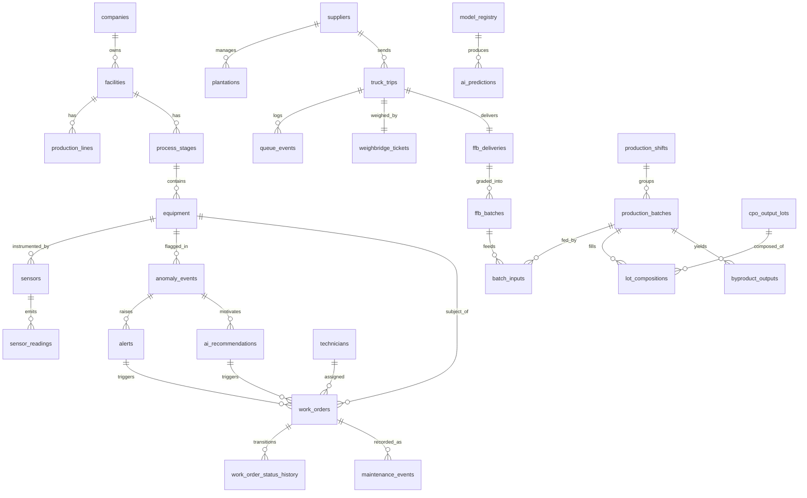

# Domain Model

> Conceptual model behind `apps/ai-api/app/models/**`. Column-level detail: `DATABASE_SCHEMA.md` (generated).
> All entities are fictional / synthetic ("Demo Palm Oil Co. (fictional)", "Demo Palm Mill A").
> Status: schema `implemented`; data generation `planned` (data-engine).

## Bounded contexts

| Context | Tables | Owns the truth about |
|---|---|---|
| Plant registry (`core`) | companies, facilities, production_lines, process_stages, equipment, sensors | What exists and where it sits in the process flow |
| Telemetry (`readings`) | sensor_readings | Raw time-series (indexed `(sensor_id, ts)`) |
| Production (`production`) | production_shifts, production_batches, process_hourly, byproduct_outputs, quality_measurements, cpo_output_lots | What was processed and produced, hourly mill state, QC |
| Logistics (`logistics`) | suppliers, plantations, truck_trips, queue_events, weighbridge_tickets, ffb_deliveries | FFB arriving: who, when, how much, what quality, how long they waited |
| Traceability (`traceability`) | ffb_batches, batch_inputs, lot_compositions | Mass-balance links supplier → delivery → FFB batch → processing batch → CPO lot |
| Maintenance (`maintenance`) | technicians, work_orders, work_order_status_history, maintenance_events | Work-order workflow and maintenance history |
| Energy (`energy`) | energy_consumption | Hourly electricity/steam/fuel/water, plant-wide or per stage |
| AI (`ai`) | model_registry, ai_predictions, anomaly_events, anomaly_status_changes, ai_recommendations, recommendation_decisions, alerts, alert_status_changes | Model versions + metrics, forecasts, detected anomalies, advisory recommendations, unified alerts, human decisions |
| Platform (`platform`) | audit_logs, scenario_runs, injected_events, business_scenarios, copilot_sessions, copilot_messages, kb_documents, kb_chunks, prices | Audit, scenario catalog, ML ground truth (private), saved what-ifs, copilot history, sample KB, illustrative prices |

## Core relationships

## Physical invariants (enforced or expected)

| Invariant | Where |
|---|---|
| `net_kg = gross_kg − tare_kg`, `0 < tare < gross` | CHECK on `weighbridge_tickets` |
| `accepted_kg ≤ net_kg`; grading percentages in [0,100] | CHECK on `ffb_deliveries` |
| OER ∈ [0,35] %, KER ∈ [0,15] %, CPO ≤ FFB, kernel ≤ FFB | CHECK on `production_batches`, `process_hourly`, `production_shifts` |
| Mass shares ∈ (0,1] | CHECK on `batch_inputs`, `lot_compositions` |
| `cpo_t ≈ ffb_t × OER`, `kernel_t ≈ ffb_t × KER`, by-products as FFB fractions | Data engine + data-quality validation (ranges from `docs/business/`) |
| Running minutes/downtime per hour ∈ [0,60] | CHECK on `process_hourly` |
| Companies are fictional | CHECK `is_fictional = true` |
| Recommendations are advisory | CHECK `advisory = true` |
| Time ordering (end ≥ start, weigh-out ≥ weigh-in, …) | CHECKs on event tables |

## Honesty markers in the model

- `data_kind` on fact tables: `synthetic`, `synthetic_actual`, `forecast`, `what_if`, `sample_document`, `user_input`.
- `injected_events` = ground-truth labels for evaluation only; listed in `app.models.PRIVATE_TABLES` and never serialised by the API.
- Risk scores are 0–100 relative scores (`ai_recommendations.risk_score`), not probabilities.
- Anomalies store `evidence_json` + `contributing_json` (possible factors), never a "cause".
- Supplier `sustainability_status` is a data-model sketch (`not_assessed` … `documented`), never a certification.

## Session scoping (ADR-006 / ADR-014)

`app.models.SESSION_SCOPED_TABLES`: work_orders, work_order_status_history, maintenance_events, anomaly_status_changes,
alert_status_changes, recommendation_decisions, business_scenarios, copilot_sessions, copilot_messages, audit_logs.
`session_id IS NULL` = seeded baseline (shared, read-only); otherwise the visitor's sandbox.

## Scenario model (ADR-011)

`scenario_runs` (one row per `ScenarioCode`) defines windows inside the single timeline: `start_ts`, `end_ts`, `focus_ts`
(default `as_of`), `baseline_ts` (comparable normal moment), primary stage/equipment, `expected_effects_json`
(what each module should show). Codes: NORMAL_DAY, OER_DEGRADATION, PRESS_VIBRATION_ANOMALY, STEAM_PRESSURE_DEVIATION,
TRUCK_QUEUE_CONGESTION, ENERGY_EFFICIENCY_DROP.
