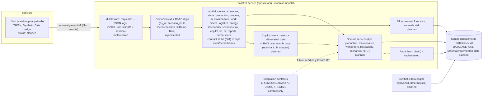

# System Architecture

> Independent concept demo on synthetic data. Status labels: `implemented` · `partial` · `prototype` · `planned`.
> Last updated by the architect at the end of wave 0 — most modules are `planned` (contract stubs).

## Overview

## Layers and rules

| Layer | Location | Rule |
|---|---|---|
| Web | `apps/web` | UI + thin proxy. No business formulas (ADR-002). Renders `provenance` badges, status chips, Synthetic Data badge. |
| Contract | `packages/contracts` | Generated from OpenAPI (`make contracts`). Never hand-edited. |
| API routers | `app/api/v1/<module>.py` | Validate input, resolve `DemoContext`, check permission, call a service, return a schema. No SQL in routers beyond trivial lookups. |
| Services | `app/services/<module>.py` | Business rules + analytics. Take `(db, ctx, ...)`, never read globals or wall-clock time for demo data. |
| ML | `app/ml/**` | Training/eval offline (`make models`, `make eval`); inference functions called by services. Artifacts in `data/models/`. |
| Copilot | `app/copilot/**` | Calls services through allow-listed tools; never raw SQL (ADR-010). |
| Models | `app/models/**` | SQLAlchemy 2.0 schema, frozen after wave 0 (additive changes only). |
| Seed | `app/seed/**` | Deterministic synthetic generator writing through the models. |

## Request lifecycle

1. `RequestContextMiddleware` assigns/echoes `X-Request-ID`, logs one JSON access line (IP hashed).
2. `RateLimitMiddleware` applies token buckets (per IP, then per session) → 429 envelope.
3. `get_demo_context` validates `as_of` (window), `scenario_id`, `X-Demo-Session` (uuid), `X-Demo-Role` (enum) → 422 envelope on error.
4. `require_permission(P)` → 403 envelope if the simulated role lacks `P`.
5. Handler → service → DB; writes call `require_session(ctx)` and `write_audit(...)` in the same transaction.
6. Errors anywhere → `{"error": {"code", "message", "details"}}`.

## Cross-module consistency

One deterministic 120-day timeline (ADR-011). Scenario `PRESS_VIBRATION_ANOMALY`, for example, is a window in which
press sensor readings, `process_hourly` press/oil-loss values, OER, anomaly events, alerts, recommendations and
energy all reflect the same injected degradation; the process twin, dashboards, maintenance, copilot and impact
calculator read those same rows at the same `as_of`.

## Observability

- `/health` (liveness, no DB) and `/ready` (DB reachable, schema present, data seeded → 200/503) — implemented.
- Structured JSON logs with request id — implemented.
- Metrics/tracing — planned (not required for the demo).

## Deployment

| Item | Status |
|---|---|
| Local: `make setup && make seed && make dev` | setup/test implemented; seed planned (data-engine) |
| Docker: `infra/docker/{api,web}.Dockerfile`, `docker-compose.yml` (+ `postgres` profile) | images **built and smoke-tested in CI** (2026-11-22); compose file and Postgres profile not run |
| CI: `.github/workflows/ci.yml` (lint, migrations, tests, contract freshness, web build, Docker build + smoke test) | ran on GitHub 2026-11-22, all jobs green |
| Public demo hosting | planned |

## Security posture (demo)

Read-only AI; human confirmation (`confirm: true`) before creating records; simulated roles enforced server-side;
session sandboxing; rate limits; strict input validation; safe uploads (size cap, allow-list, magic-byte sniffing,
sanitised names, in-memory only); no secrets in repo (`.env.example` only); IPs hashed in logs. See ADR-006/007/012/013.
