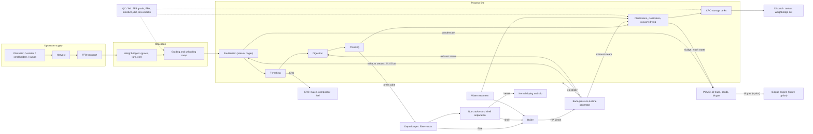

# Palm Mill Process Map

> Task DML-003. Owner: researcher. Retrieved **2026-11-21**. Independent concept demo; describes a **generic** palm oil mill of the size common in Thailand (the fictional "Demo Palm Mill A", 60 t FFB/h), not any company's facility. Parameter keys in `code` refer to `docs/business/DOMAIN_PARAMETERS.json`; source IDs (S15, S16...) to `ASSUMPTION_REGISTER.md` section F. Tags: **[IP]** Industry Practice, **[EA]** Engineering Assumption, **[SDD]** Synthetic Demonstration Data.

**Instrumentation caveat.** The "typical sensors" below describe a mill with a DCS/SCADA layer. Many mills have only local gauges and paper logs for parts of the line. What a given organisation (or any real plant) has is unknown and is a discovery question, not an assumption the demo makes on its behalf.

## 1. Flow diagram

## 2. Reference day (calculation example, synthetic)

At nominal parameters: 60 t/h design x 20 h x 0.78 utilisation = **936 t FFB processed per day** (46.8 t/h while running).

| Flow | Rule (parameter) | Value per day |
|---|---|---|
| CPO | OER 18.2% (`oer_pct`) | 170.4 t (about 6 tanker loads of 28 t) |
| Palm kernel | KER 5.2% (`ker_pct`) | 48.7 t |
| EFB | 22% | 205.9 t |
| Fibre | 13.5% | 126.4 t |
| Shell | 5.5% | 51.5 t |
| POME | 0.65 t/t | 608 t (about 608 m3) |
| Steam | 0.50 t/t | 468 t (23.4 t/h; 58% of 40 t/h installed boiler capacity) |
| Electricity | 17 kWh/t | 15.9 MWh (average 796 kW while running) |
| Water | 1.4 m3/t | 1,310 m3 |
| Oil lost in residues | 1.0% of FFB | 9.4 t oil equivalent (inside the 18.2% net) |
| Inbound trucks | mean payload 10.85 t | about 86 trips |

Note that CPO + kernel + EFB + fibre + shell = 64.4% of FFB mass. The rest of the FFB mass leaves as water (evaporation, condensate, POME) and dissolved solids. A generator must **not** force the five outputs to sum to 100%.

## 3. Stage-by-stage map

### Stage 0 - Plantation (supply side)
- **Purpose:** produce ripe FFB. **Inputs:** palms (tenera), rainfall, fertiliser, labour. **Output:** bunches (average 19.7 kg in a Surat Thani study, `ffb_bunch_weight_kg`; national yield about 3.3 t/rai/yr, `ffb_yield_t_per_rai_per_year`).
- **Key parameters:** ripeness at cutting; seasonal yield (Sep peak, Feb trough in the Surat Thani study, S20); yield responds to rain with lags of months to two years (S20, S21).
- **Data a plantation typically keeps:** block, harvest date, bunch counts, weight, yield per rai. Not available to the mill in real time.
- **Failure modes and symptoms:** drought or El Nino year (lower yield some months later), pest/disease (patchy supply), under-cutting cycles (more overripe, loose fruit), labour shortage (unripe or late harvest).
- **Quality/loss:** unripe bunches lower OER, KER and CPO quality; overripe bunches raise FFA and loose-fruit loss (S40).

### Stage 1 - Harvest
- **Purpose:** cut ripe bunches, collect loose fruit, load. **Rule of thumb [IP]:** deliver the same day.
- **Parameters:** cutting standard (ripeness by loose fruit); target harvest-to-sterilizer time 24 h (`ffb_harvest_to_sterilizer_target_h`).
- **Failure modes:** unripe harvest, late loading, rain; symptom is a rising unripe share and FFA at the mill.
- **Loss:** bruising and loose fruit left in the field; every hour of delay adds FFA (see Stage 2).

### Stage 2 - FFB transport (estate, ramp, mill)
- **Purpose:** move FFB to the mill. In Thailand 75-80% of smallholder FFB passes through ramps (S14), so deliveries are often consolidated into 10-wheel trucks and trailers.
- **Parameters:** payload by class (`truck_payload_*_t`), mix (`truck_mix_trip_share`), haul 35 km at 35 km/h (`ffb_haul_distance_km`, `truck_average_speed_kmh`), transit guideline 8 h (`ffb_transport_max_h`, low confidence).
- **Sensors/data:** delivery ticket, GPS (future), weighbridge ticket. 
- **Failure modes:** truck breakdown, road/weather, convoy arrivals; symptom is bunched arrivals and long queues.
- **Quality/loss:** bruising, loose fruit loss, weight loss while waiting (`ffb_weight_loss_pct_per_day_wait`, low).

### Stage 3 - Weighbridge
- **Purpose:** legal-for-trade weight and traceability: gross in, tare out, net = gross - tare; supplier, vehicle, time.
- **Equipment:** 1-3 platform weighbridges with load cells, indicator, ticket printer, barrier/gate; (future) licence-plate reading.
- **Parameters:** service time about 2 min per event, two events per trip (`weighbridge_service_min_per_event`, `weighbridge_events_per_trip`, both EA).
- **Sensors:** gross, tare, net weight; stability flag; timestamps; calibration date.
- **Failure modes:** load-cell drift (net weight bias), indicator fault, communication loss, queue spill-back. Symptom of drift: repeat trucks' tare changes systematically.
- **Anomalies (never accusations):** net weight outside class payload range, tare changing unexpectedly, very long dwell. These are data-quality flags to review, not proof of wrongdoing.

### Stage 4 - FFB reception, grading, unloading
- **Purpose:** inspect and grade bunches, apply deductions, unload to the ramp/hopper, feed sterilizer cages.
- **Equipment:** grading bay, unloading bays with hydraulic tipping or ramps (`unloading_bays` = 3, `unloading_rate_t_per_min_per_bay` = 1.0), ramp buffer (`ramp_buffer_capacity_t` = 300 t), loaders, cage loading system.
- **Parameters:** unripe 4%, overripe 8%, dirt 1% of weight, grading deduction about 1.5% (all EA, low).
- **Sensors/data:** grade result, ripeness counts, deduction, bay status, ramp stock (by hopper level or loader count).
- **Failure modes:** tipping hydraulics, conveyor/chain stoppage, loader unavailability; symptom: unloading rate falls, ramp stock climbs, wait-to-process time grows.
- **Quality/loss:** grading quality sets feedstock quality; deductions are a commercial term between mill and supplier (practice in Thailand not confirmed publicly).
- **Key link:** wait-to-process time = ramp stock / throughput (`REL-05`). This is how congestion in logistics becomes FFA in production.

### Stage 5 - Sterilization
- **Purpose:** steam-cook bunches to stop enzyme (lipase) activity, loosen fruit from the bunch, soften mesocarp, condition nuts.
- **Inputs:** FFB in cages (2.5 t each, `sterilizer_cage_capacity_t`); steam from the back-pressure header. **Outputs:** cooked bunches, condensate (to POME).
- **Equipment:** 5 horizontal autoclaves x 8 cages (`sterilizer_vessel_count`, `sterilizer_cages_per_vessel`, EA) with doors, steam inlet and exhaust valves, condensate traps, cage tipper.
- **Parameters [IP, S16]:** about 40 psig = 2.8 bar(g) (`sterilizer_pressure_barg`), 60-90 min (`sterilizer_cycle_min` nominal 80), steam about 140 C, steam use 140-224 kg/t FFB (`sterilizer_steam_kg_per_t_ffb` nominal 200). Triple-peak cycles step the pressure: an initial low peak (about 1.0-1.5 bar) then two high peaks near 2.8-3.0 bar; the staging values are **[EA]**.
- **Sensors:** vessel pressure, temperature, valve states, cycle phase/time, steam flow to sterilizers, condensate level.
- **Failure modes and symptoms:** steam leak or door seal failure (peak pressure not reached, cycle extends), failed condensate trap (slow heat-up, high condensate), valve actuator fault (stuck phase), low header pressure from the boiler (all vessels slow together - see scenario STEAM_PRESSURE_DEVIATION).
- **Quality/loss:** undercooked bunches strip poorly and leave oil in EFB and nuts; overcooked or overlong cycles waste steam and can raise oil loss into condensate (about 0.1% of FFB, `oil_loss_sterilizer_condensate_pct_ffb`). Sterilizer steam is the largest single steam consumer.

### Stage 6 - Threshing (stripping)
- **Purpose:** separate fruitlets from cooked bunches; the empty bunch (EFB, about 22% of FFB) leaves the line.
- **Equipment:** drum thresher(s), EFB conveyors, fruit conveyor/elevator.
- **Parameters:** unstripped bunches about 1% (`thresher_unstripped_bunch_pct`, EA).
- **Sensors:** thresher motor current, vibration, drum speed, conveyor states.
- **Failure modes:** bearing wear, drum or chain damage, conveyor jams; symptom: rising vibration, motor current spikes, high unstripped bunches in EFB.
- **Loss:** oil on EFB (about 0.07% of FFB, `oil_loss_efb_pct_ffb`, EA).

### Stage 7 - Digestion
- **Purpose:** heat and mash fruitlets so the oil cells rupture and oil can be pressed.
- **Equipment:** steam-jacketed digesters with stirring arms (6 units in the demo, `digester_count`), driven by about 37 kW motors (EA).
- **Parameters [IP, S29]:** mash temperature 90-96 C (`digester_temp_c` 93), residence about 25 min (EA).
- **Sensors:** mash temperature, motor current, level, steam valve position.
- **Failure modes:** worn stirring arms (poor mashing, lower current), low steam (temperature falls below about 88 C), bearing/gearbox faults.
- **Quality/loss:** poorly digested fruit increases oil left in fibre and nuts, lowering OER.

### Stage 8 - Pressing
- **Purpose:** squeeze crude oil out of the digested mash; remaining press cake (fibre + nuts) goes to kernel recovery.
- **Equipment:** twin screw presses (6 units, 10 t FFB/h each; 55 kW motors, EA) with gearboxes and cone/back-pressure control; a second-stage press on fibre is sometimes used.
- **Parameters:** motor load about 80% of full-load current (`press_motor_load_fraction`), cone pressure about 40 bar (`press_cone_pressure_bar`, EA, no public number found), residual oil in pressed fibre 5-11% of dry matter (`fibre_oil_pct_dry_basis` 7, S17) equal to about 0.25-0.55% of FFB (`oil_loss_fibre_pct_ffb` 0.35), pressed-fibre moisture about 36% (S17).
- **Sensors:** motor current, gearbox and motor vibration, bearing temperatures, hydraulic cone pressure, throughput (via feed), crude oil flow.
- **Failure modes and symptoms:** worn screw/cage (current up or erratic, vibration up, more oil in fibre, broken nuts), bearing/gearbox damage (vibration and temperature rise, usually weeks of drift before failure), overload from heavy feed (current up without vibration change).
- **Quality/loss:** higher pressure lowers oil in fibre but raises broken nuts and kernel loss; a worn press loses both. This is the physical basis of the PRESS_VIBRATION_ANOMALY scenario.

### Stage 9 - Clarification and purification
- **Purpose:** separate oil from water, sludge and fine solids; dry the oil.
- **Equipment:** vibrating (crude oil) screens, crude oil tank, continuous clarification tank, sludge separators (vertical centrifuges) or decanter, oil purifier, vacuum dryer, sludge tank, oil recovery from sludge.
- **Parameters [IP, S16]:** clarifier 85-95 C (`clarifier_temp_c` 90), retention 1-3 h (`clarifier_retention_h` 2); oil in sludge about 0.4% of FFB (`oil_loss_sludge_pct_ffb`, vendor figure, low); after drying, moisture about 0.15% and dirt about 0.04% (EA).
- **Sensors:** tank temperatures and levels, separator motor current and vibration, flow meters, vacuum pressure, (lab) sludge oil.
- **Failure modes:** cold clarifier (steam shortage) raises sludge oil loss; separator imbalance or bearing fault (vibration, trip); foaming/emulsions; sludge pump failure; dryer vacuum loss (higher moisture).
- **Quality/loss:** the main route by which operating discipline (temperature, dilution, retention) moves OER by tenths of a percentage point.

### Stage 10 - CPO storage
- **Purpose:** buffer and hold CPO at 35-55 C (`cpo_storage_temp_c` 50) until dispatch; heating coils prevent solidification, excess heat accelerates FFA rise.
- **Equipment:** 3 tanks of about 1,500 t (EA), heating coils, level transmitters, temperature probes, sampling points.
- **Sensors:** level (convert to mass with density 0.891 t/m3 near 50 C, `cpo_density_t_per_m3`), temperature, (lab) FFA and moisture/dirt.
- **Failure modes:** heating failure (solid fat, pumping problems), level sensor error (stock mismatch affects OER), contamination.
- **Quality:** FFA drifts up with time, temperature and moisture (S28); stock-change error is the biggest pitfall when computing daily OER (see KPI_DEFINITIONS).

### Stage 11 - Dispatch
- **Purpose:** load CPO tankers (about 28 t, `cpo_tanker_payload_t`, EA), weigh out, issue delivery documents.
- **Sensors/data:** tanker gross/tare, seal numbers, sample ID, FFA and moisture at loading, time in/out.
- **Failure modes:** pump or hose fault, weighbridge queue, quality rejection at buyer.
- **Link:** dispatched mass + stock change = CPO produced for OER.

### Support A - Kernel recovery
- **Process:** press cake goes through a depericarper (fibre separated from nuts), nut conditioning silo, nut cracker, shell/kernel separation (winnowing/hydrocyclone), kernel drying below about 7% moisture (S16) and silo storage.
- **Parameters:** KER 5.2% (`ker_pct`, range 4.5-6.0), shell 5.5%, fibre 13.5%.
- **Sensors:** cracker motor current, vibration, kernel dryer temperature, silo level, lab kernel quality.
- **Failure modes:** cracker wear (kernels left in shell, broken kernels), poor separation (shell in kernel), dryer fault (high moisture, FFA rise in kernel).
- **Loss:** kernel lost in shell and fibre; unripe fruit lowers KER (S40).

### Support B - Boiler and steam
- **Process:** fibre and shell (sometimes EFB) are burned in a water-tube boiler; high-pressure steam (about 21 bar(g), S30, low confidence) drives a back-pressure turbine; exhaust steam (about 1.5-3.5 bar(g)) feeds sterilizers, digesters and clarification.
- **Equipment:** 2 boilers (40 t/h installed, EA), feed water pumps, ID and FD fans, fuel feeders, ash handling, back-pressure receiver, dump condenser or atmospheric vent.
- **Parameters:** steam 0.50 t/t FFB (`steam_t_per_t_ffb`, 0.42-0.65), boiler efficiency about 60%, overall steam-to-electricity efficiency about 12% (S15).
- **Fuel check (derived from S15):** fibre and shell give about 2.6 GJ HHV per tonne FFB; with moisture and 60% boiler efficiency they roughly cover the steam need with a surplus of about 20%. A 15% steam-intensity rise leaves only about 4%, so EFB supplementing or a steam shortfall becomes plausible.
- **Sensors:** steam pressure and flow, drum level, feed water flow/pressure, flue gas O2 and temperature, fan currents and vibration, fuel feeder speed, BPV pressure.
- **Failure modes and symptoms:** tube leak (feed water up, drum level unstable), fan bearing/imbalance (vibration), wet fuel (pressure sags, O2 swings), feed pump failure. A pressure drop propagates to the sterilizer cycle time, digester and clarifier temperatures and then to OER - the cross-module chain of STEAM_PRESSURE_DEVIATION.

### Support C - Power
- **Process:** turbine generator (1.5 MW installed in the demo, EA) covers about 1 MW average demand (17 kWh/t FFB x 60 t/h); a standby diesel genset (800 kW, EA) covers start-up and outages; grid import is small in self-sufficient mills (S26).
- **Sensors:** generator kW, kvar, frequency, voltage, turbine speed/vibration, bearing and oil temperatures, genset fuel use, grid import.
- **Failure modes:** turbine trip (genset starts, diesel use jumps), governor hunting, grid interruption.

### Support D - Water
- **Process:** raw water, treatment and softening, boiler make-up, process water, hot water for dilution; about 1.4 m3 per t FFB (S38).
- **Sensors:** raw water flow, tank levels, conductivity/hardness, pump currents.
- **Failure modes:** low supply in dry months, softener breakthrough (boiler scaling), pump faults.

### Support E - POME, biogas, biomass
- **POME:** about 0.65 t per t FFB (S16; WUR says more than 0.6, S15), from sterilizer condensate, clarification sludge and hydrocyclone water. COD about 65,000 mg/L (EA, S39 design figure 80,000). Treated in oil traps, cooling and anaerobic ponds or covered lagoons.
- **Biogas option:** 25-33 m3 biogas per m3 POME at 55-65% methane (S39, low confidence) and about 2 kWh electricity per m3 (EA). At 60 t/h this is of the order of 2 MWe potential, but it is a **project/what-if**, not an installed asset in the demo unless the data engine models it explicitly. A roughly 0.95 MW biogas engine exists at one Thai mill (S19), showing scale.
- **Biomass:** EFB (60% moisture), fibre (17-40%), shell (10-25%) HHV about 19 GJ/t dry (S15). EFB is often returned to the plantation as mulch or sold as fuel.
- **Sensors:** pond levels and temperatures, biogas flow, CH4 content, flare status, effluent BOD/COD (lab).
- **Failure modes:** pond overload (smell, low pH), cover leak, engine downtime; symptoms: biogas flow and methane fall.

### Support F - QC and laboratory
- **Samples:** FFB grading, sterilizer condensate, press cake/fibre residual oil, EFB oil, sludge oil, CPO (FFA, moisture and dirt), kernel, POME.
- **Typical frequency:** per delivery for FFB grading; hourly or per shift for process checks; per tank/tanker for CPO (EA).
- **Data:** lab results should link to batch/tank IDs. LIMS integration is a future capability.
- **Failure modes:** sampling bias, delayed results (OER corrective actions are late), unit mix-ups (dry vs wet basis).

## 4. Typical sensor catalogue (for the data engine; ranges are [EA] unless noted)

| Tag | Unit | Normal range | Alert logic |
|---|---|---|---|
| Sterilizer vessel pressure (peak) | bar(g) | 2.6-3.0 at peak | Warning if peak < 2.5 or cycle > 95 min |
| Sterilizer cycle time | min | 70-90 | Warning > 95 |
| Digester temperature | C | 90-96 [IP] | Warning < 88 or > 100 |
| Digester motor current | % FLA | 60-85 | Warning > 100 |
| Press motor current | % FLA | 70-90 | Warning > 100 or +10% vs 7-day baseline |
| Press gearbox vibration | mm/s RMS | 0.8-2.3 | ISO zone logic below |
| Press bearing temperature | C | 55-75 | Alarm baseline +10 or > 85 |
| Clarifier temperature | C | 88-93 | Warning < 85 |
| Sludge separator vibration | mm/s RMS | 0.8-2.8 | ISO zone logic |
| CPO tank temperature | C | 45-55 | Warning < 40 or > 57 |
| CPO tank level | m / t | 10-90% | Mismatch with expected stock flags measurement error |
| Boiler steam pressure | bar(g) | 19-22 | Warning deviation > 10% from setpoint |
| BPV/process steam header | bar(g) | 2.8-3.2 | Warning < 2.5 |
| Steam flow | t/h | 20-35 at nominal | Compare to 0.5 t/t FFB; > +10% flags intensity |
| Turbine generator output | kW | 600-1,300 | Compare to 17 kWh/t FFB |
| Fan motor vibration (ID/FD) | mm/s RMS | 1.0-2.8 | ISO zone logic |
| Raw water flow | m3/h | 50-80 at nominal | Compare to 1.4 m3/t FFB |
| POME flow | m3/h | 25-45 | Compare to 0.65 t/t FFB |
| Biogas flow (if modelled) | m3/h | 700-1,100 | Compare to 28 m3/m3 POME |
| Weighbridge weight | t | 0-80 | Net outside payload class flags review |
| Ramp stock | t | 50-600 | Wait = stock / throughput |

Vibration zones (S24, **[IP]**, med confidence): Group 2 rigid 1.4 / 2.8 / 4.5 mm/s; Group 2 flexible 2.3 / 4.5 / 7.1; Group 1 rigid 2.3 / 4.5 / 7.1; Group 1 flexible 3.5 / 7.1 / 11.0 (A/B, B/C, C/D). Group 2 = 15-300 kW; Group 1 = above 300 kW. One source lists 3.5 for Group 2 rigid B/C; the majority value 2.8 is used. ISO 10816-3 is superseded by ISO 20816-3 with the same limits; verify against the licensed standard before any real use. Slow screw speeds are not covered well by the standard: apply it to motor and gearbox housings and say so.

## 5. Cause-and-effect model for the six scenario seeds

Each scenario must show **consistent** signatures in process flow, sensors, KPIs, anomaly output, maintenance alert, copilot context and scenario impact. Effect sizes are **[SDD]** design choices (see `scenario_effects` rows) built on the sourced baseline ranges.

| Scenario | Root cause chain | Signature to generate | Expected business effect |
|---|---|---|---|
| NORMAL_DAY | none | all tags in range; OER 18.2% +- 0.25 pp daily noise; trucks about 86; wait-to-process under about 6 h | baseline |
| OER_DEGRADATION | unripe share +8 pp (about -0.64 pp OER), extra fibre loss +0.30 pp, clarifier 5 C cold (sludge loss x1.5, about +0.20 pp) | OER down about 1.1 pp over 5-10 days; unripe share and lab sludge oil up; press current slightly up; CPO per day down about 10 t at 936 t FFB | direct lost CPO about 10 t/day (value at illustrative price) |
| PRESS_VIBRATION_ANOMALY | bearing/gearbox wear on one press | vibration climbs over about 14 days from about 1.6 to about 4.8 mm/s (crossing the B/C then C/D boundary only near the end), bearing temp +10 C, motor current +12%, fibre oil +0.3 pp, throughput -8% on that line | maintenance alert, inspection window, risk of unplanned stop (about 2 h mean) |
| STEAM_PRESSURE_DEVIATION | boiler or BPV pressure -15% for about 8 h | sterilizer peak pressure short, cycles +15 min, digester/clarifier temperatures fall, throughput down, extra loss 0.15 pp, energy/t up | short OER dip, steam shortfall, possible EFB top-up |
| TRUCK_QUEUE_CONGESTION | arrivals x1.8 for about 4 days in peak season, or unloading bay outage | queue length and wait 3-5 h, ramp stock up, wait-to-process 12-30 h, FFA +0.4-1.0 pp (via 0.03 pp/h beyond 8 h), turnaround 150+ min | FFA risk, supplier dissatisfaction, deferred processing |
| ENERGY_EFFICIENCY_DROP | steam leaks, wet fuel, idle running | steam 0.50 -> 0.575 t/t, electricity 17 -> 18.7 kWh/t, boiler load 58% -> 67%, biomass surplus shrinks, diesel use up if turbine derates | energy cost per t up, fuel shortfall alert |

Cross-links to keep: logistics queue -> wait-to-process -> FFA (and a small OER effect); press degradation -> throughput and OER; steam deviation -> sterilizer, digester, clarifier -> OER and energy/t; energy drop -> cost/t. Maintenance work orders must change the later series (recovery after repair), otherwise the what-if is incoherent.

## 6. Quality and loss mechanisms in one view

| Mechanism | Where | Direction | Order of magnitude (sourced or assumed) |
|---|---|---|---|
| FFB delay -> FFA rise | reception, ramp | FFA up | about +0.03 pp per hour beyond 8 h [EA, S22 single lab study: 2.96% to 5.14% in 48 h] |
| Unripe bunches | harvest, grading | OER, KER, quality down | about -0.08 pp OER per pp unripe [EA, S40 direction only] |
| Sterilizer under/over-cooking | sterilizer | oil left in EFB/nuts or in condensate | condensate loss about 0.1% of FFB [IP, S16] |
| Poor digestion | digester | more oil in fibre | within fibre loss 0.25-0.55% [IP, S17] |
| Press wear | press | oil in fibre, broken nuts | up to about +0.3 pp [SDD] |
| Cold clarifier / poor retention | clarifier | sludge oil loss | about 0.4% of FFB, up to x1.5 [IP low, SDD] |
| EFB oil | thresher/sterilizer | small loss | about 0.07% of FFB [EA] |
| Kernel loss | cracker/separation | KER down | KER 4.5-6.0% |
| CPO storage heat/moisture | tanks | FFA drift up | about 0.05 pp/day [EA, S28 direction] |
| Measurement error | tank dips, ticket weights | apparent OER noise | daily SD about 0.25 pp [SDD] |

## 7. Traps for the data engine (things that look fine on a chart but are wrong)

1. Outputs summing to 100% of FFB (they should sum to about 64%).
2. OER as a smooth constant: real daily OER is noisy and lags the process by hours; weekly OER is the stable signal.
3. Throughput above design capacity without a queue: excess FFB must wait on the ramp.
4. Mill running at full rate in the lean season (utilisation about 50%) or at 100% for weeks in the peak.
5. Steam, electricity, water and POME that do not scale with throughput; or steam per tonne that stays flat while the sterilizer scenario is active.
6. Vibration states chosen at random instead of derived from the ISO thresholds.
7. FFA moves while ramp stock and wait times do not.
8. CPO stock that goes negative or does not equal produced minus dispatched.
9. Treating stoppage for lack of FFB as equipment downtime.
10. Truck net weights that are negative or beyond the class payload without a flagged explanation.
11. Prices that make the mill wildly profitable: at CPO 40 THB/kg, OER 18.2% and FFB 7.5 THB/kg the oil revenue just covers FFB cost (see `REL-16`).
12. A 120-day window that ignores the Aug-Oct peak and Nov decline.

## 8. Sources used in this document

S10, S13-S19, S20, S21, S22, S24, S28, S29, S30, S37, S38, S39, S40 and A00 (assumption). Details, URLs and caveats: `docs/business/ASSUMPTION_REGISTER.md` section F.
